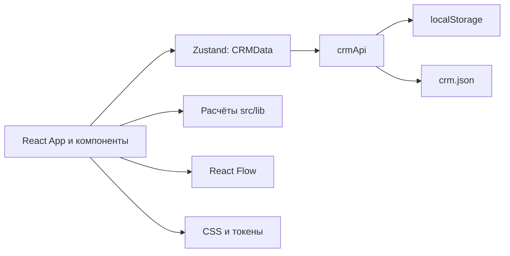
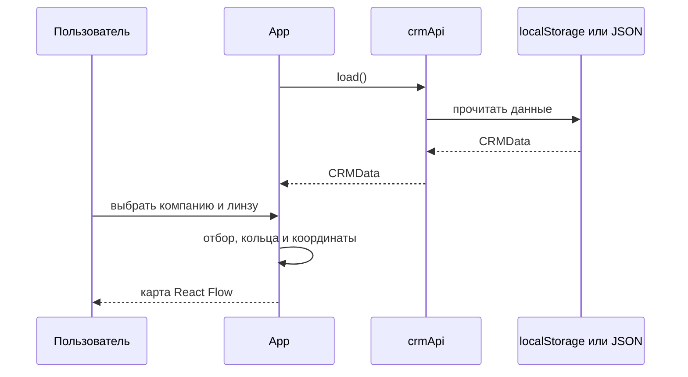
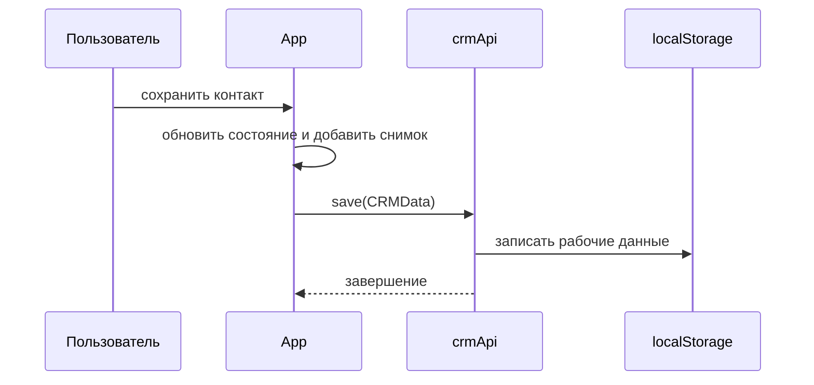

# Архитектура

`package.json` задаёт React 19, TypeScript, Vite, `@xyflow/react`, Zustand, Tailwind и CSS. Их использование видно в `src/App.tsx`, `src/main.tsx`, `vite.config.ts`; причины выбора автора требуют уточнения.

`src/main.tsx` подключает шрифты, тему и React. `src/App.tsx` загружает данные, хранит состояние интерфейса и формирует узлы и рёбра; Zustand содержит `data` и `setData`. `src/lib/` содержит расчёты, `src/components/` — интерфейс, `src/styles/tokens.css` — токены.

Исходная загрузка показывает skeleton, при переключении клиента также есть временный skeleton (`src/components/LoadingSkeleton.tsx`, `src/App.tsx`). При ошибке разбора сохранённого JSON слой данных возвращает исходное состояние; начальная загрузка и сохранение не имеют общего обработчика ошибок, а раздел CRM отдельно показывает ошибки (`src/api/crmApi.ts`, `src/components/Integration.tsx`).

Применяются `memo`, `useMemo`, анимация позиций, React Flow и подсветка соседей через DOM (`src/App.tsx`). Раскладка проверяет пересечения; тестируется плотное размещение, но гарантий производительности для 40+ узлов нет (`src/lib/orbitLayout.ts`, `tests/orbitLayout.test.mjs`).
