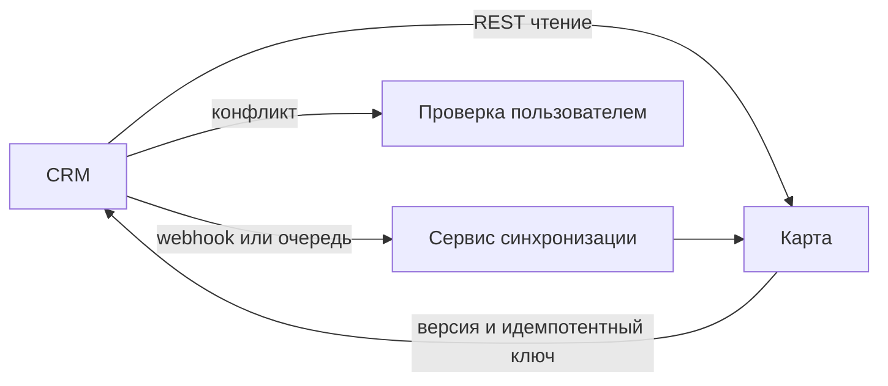

# Интеграция с CRM

Слой `src/api/crmApi.ts` имитирует асинхронный API задержкой 150–400 мс. Это локальные функции, HTTP-запросов нет.

## Откуда берутся данные и как обновляются

| Поток | Что работает в MVP | Как это могло бы работать у КРОК |
|---|---|---|
| Карточка клиента и история | Синтетическая выгрузка через существующий локальный адаптер. На показе явно указываем происхождение данных | Компании, контакты, ответственные и доступные звонки, письма и встречи из CRM КРОК |
| Интервью, отзыв или протокол | Пользователь добавляет источник. Локальные правила предлагают поля, человек проверяет неоднозначные выводы. Подтверждённая запись попадает в историю с датой, автором и фрагментом | Согласованный импорт новых событий и материалов из доступных систем. Формат, периодичность и перечень источников определяются при подключении |
| Актуализация карты | Давность касания, интенсивность, упоминания и сигнал зависимости пересчитываются из сохранённых событий. При недостатке данных выводим «Нет данных». Для роли и силы связи сохраняем подтверждение с источником | Регулярно получать доступные CRM-события, пересчитывать сигналы, отправлять спорные выводы на проверку |
| Возможный обратный обмен | Предпросмотр diff по выбранной компании и локальное подтверждение | Передача согласованных наблюдений и правок обратно в CRM КРОК в согласованном формате |

На защите показать, что новая датированная запись пересчитывает показатели без повторной ручной разметки карты. Синтетические статусы писем демонстрируют метрику, реальное отслеживание отправки и открытий потребует источника измерений.

## Локальный адаптер

| Метод | Поведение |
|---|---|
| `load(): Promise<CRMData>` | Читает рабочую копию; при отсутствии — базовую копию или исходный JSON |
| `save(data): Promise<void>` | Записывает рабочую копию в `decision-radar-v1`, затем возвращает Promise задержки. Ошибка setItem возникает до публикации состояния |
| `saveInteraction(data, companyId, draft, change, today, onCommit): Promise<SaveResult>` | Проверяет и одним setItem записывает источник, необязательную правку и квитанцию. onCommit вызывается после записи, до задержки; общий UI получает SaveInteraction из App |
| `reset(): Promise<CRMData>` | Удаляет рабочую копию и возвращает базовую |
| `loadBaseline(): Promise<CRMData>` | Читает базовую имитацию CRM |
| `confirmCompany(data, companyId): Promise<CRMData>` | Заменяет людей, связи, взаимодействия и снимки выбранной компании в базовой копии `decision-radar-simulated-crm-v1` |

Если снимки отсутствуют, миграция добавляет снимки текущих людей и сохраняет применимые снимки исходного набора (`src/api/crmApi.ts`).

| Получает из имитации | Зачем |
|---|---|
| Компании: id, название, отрасль, инициатива, описание | Выбор и контекст |
| Контакты, оценки, интересы и согласие | Карта и фильтры |
| Связи, взаимодействия, снимки | Рёбра, история, аналитика |

| Создаётся или меняется в карте | Действие |
|---|---|
| Контакт, роль, позиция, теплота, влияние, владелец | Ручная форма |
| Связь и её сила | Ручная форма |
| Снимок человека | При сохранении, удалении и принятии некоторых предложений |
| Интервью и обратная связь | Ручной ввод с датой, автором и исходным фрагментом; новое наблюдение пересчитывает историю и давность касания. Расширенные показатели подключает C |
| Предложения | Локальный разбор текста; до принятия остаются состоянием интерфейса |

| Возвращается в имитацию | Триггер и формат |
|---|---|
| Контакты, связи, взаимодействия и снимки выбранной компании | Кнопка подтверждения в разделе CRM; JSON-объект CRMData в localStorage |

Предпросмотр показывает изменения полей контактов, связей и взаимодействий относительно базовой копии; снимки копируются при подтверждении, но отдельными строками diff не показываются (`src/lib/crmDiff.ts`, `src/components/Integration.tsx`, `src/api/crmApi.ts`). Компания не переписывается. Не все перечисленные поля можно изменить через интерфейс.

## Предложение для реальной интеграции

Предложение, не реализовано: читать компании, контакты и активности через REST с авторизацией и правами по компании; отправлять изменения с версией записи и идемпотентным ключом. Webhook или очередь могли бы доставлять изменения; при конфликте версии потребуется сравнение полей и решение пользователя. Частота резервной сверки и политика хранения требуют согласования с владельцем CRM. Возможное сопоставление: Company → карточка компании, Person → контакт, Interaction → активность, Relation и оценки → отдельные связанные записи или расширенные поля; задачи в текущей модели отсутствуют.

В пакете A diff форматирует `evidence` по-русски: источник, фрагмент, упоминания с именами, предпочтения собеседника, поставщик и причина. Квитанции повторов не являются строками обмена. После ручного контрольного интервью появляется ровно одно взаимодействие; источник плюс подтверждённая правка роли/силы дают две строки. Браузерное локальное подтверждение проверено в двух чистых профилях; реальный обмен не выполнялся. [Отчёт A](plans/reports/A-integration-2026-11-19.md).
