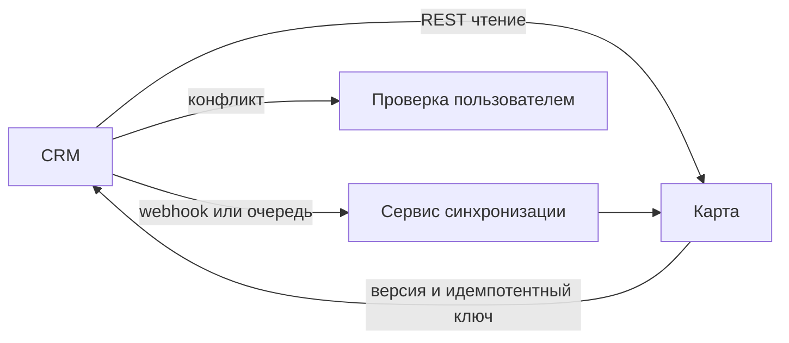

# Интеграция с CRM

Слой `src/api/crmApi.ts` имитирует асинхронный API задержкой 150–400 мс. Это локальные функции, HTTP-запросов нет.

| Метод | Поведение |
|---|---|
| `load(): Promise<CRMData>` | Читает рабочую копию; при отсутствии — базовую копию или исходный JSON |
| `save(data): Promise<void>` | Записывает рабочую копию в `decision-radar-v1`, затем ожидает задержку |
| `reset(): Promise<CRMData>` | Удаляет рабочую копию и возвращает базовую |
| `loadBaseline(): Promise<CRMData>` | Читает базовую имитацию CRM |
| `confirmCompany(data, companyId): Promise<CRMData>` | Заменяет людей, связи, взаимодействия и снимки выбранной компании в базовой копии `decision-radar-simulated-crm-v1` |

Если снимки отсутствуют, миграция добавляет снимки текущих людей и сохраняет применимые снимки исходного набора (`src/api/crmApi.ts`).

| Получает из имитации | Зачем |
|---|---|
| Компании: id, название, отрасль, инициатива, описание | Выбор и контекст |
| Контакты, оценки, интересы и согласие | Карта и фильтры |
| Связи, взаимодействия, снимки | Рёбра, история, аналитика |

| Создаётся или меняется в карте | Действие |
|---|---|
| Контакт, роль, позиция, теплота, влияние, владелец | Ручная форма |
| Связь и её сила | Ручная форма |
| Снимок человека | При сохранении, удалении и принятии некоторых предложений |
| Предложения | Локальный разбор текста; до принятия остаются состоянием интерфейса |

| Возвращается в имитацию | Триггер и формат |
|---|---|
| Контакты, связи, взаимодействия и снимки выбранной компании | Кнопка подтверждения в разделе CRM; JSON-объект CRMData в localStorage |

Предпросмотр показывает изменения полей контактов, связей и взаимодействий относительно базовой копии; снимки копируются при подтверждении, но отдельными строками diff не показываются (`src/lib/crmDiff.ts`, `src/components/Integration.tsx`, `src/api/crmApi.ts`). Компания не переписывается. Не все перечисленные поля можно изменить через интерфейс.

## Предложение для реальной интеграции

Предложение, не реализовано: читать компании, контакты и активности через REST с авторизацией и правами по компании; отправлять изменения с версией записи и идемпотентным ключом. Webhook или очередь могли бы доставлять изменения; при конфликте версии потребуется сравнение полей и решение пользователя. Частота резервной сверки и политика хранения требуют согласования с владельцем CRM. Возможное сопоставление: Company → карточка компании, Person → контакт, Interaction → активность, Relation и оценки → отдельные связанные записи или расширенные поля; задачи в текущей модели отсутствуют.

